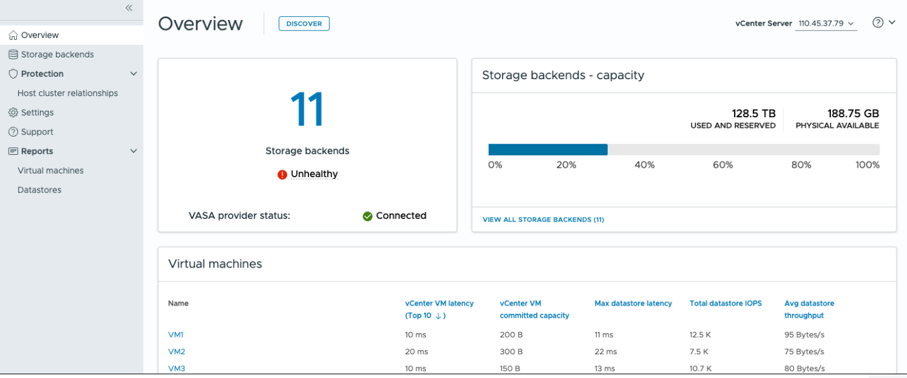

= ONTAP tools for VMware vSphere ダッシュボードについて
:allow-uri-read: 
:icons: font
:imagesdir: ../media/

[role="lead"]
vCenterクライアントのショートカット セクションからONTAP tools for VMware vSphereプラグイン アイコンを選択してダッシュボードを開きます。ダッシュボードには、プラグイン、データストア、およびvCenter Serverデータのステータスが要約されています。

拡張リンク モード (ELM) では、vCenter Server ドロップダウンが表示されます。データを表示する vCenter Server を選択します。ドロップダウンはプラグインのすべてのリストビューで利用できます。あるページでvCenter Serverを選択すると、プラグイン内のタブを切り替えても同じ内容が保持されます。

概要ページから、*検出*アクションを実行して、新しく追加または更新されたストレージバックエンド、ホスト、データストア、およびvCenterレベルでの保護ステータスまたは関係を検出できます。スケジュールされた検出を待たずに、オンデマンド検出を実行します。

保護対象のホストクラスタに新しいホストを追加すると、保護設定が「部分的に保護」に変更されます。

この状態を解決するには、「クラスタ構成の変更」を開き、ホストを正しいサイト（ソースまたはターゲット）に割り当てて、「変更」を選択します。

NOTE: *Discovery* ボタンは、検出を実行するために必要な権限を持っている場合にのみ有効になります。

検出要求が送信された後、最近のタスク パネルでアクションの進行状況を追跡できます。

ダッシュボードには、システムのさまざまな要素を示す複数のカードがあります。次の表に、さまざまなカードとその意味を示します。

|===

| *カード* | * 概要 * 

| ステータス | ステータスカードには、ストレージバックエンドの数と、ストレージバックエンドおよびVASA Providerの全体的な健全性ステータスが表示されます。ストレージバックエンドのステータスは、すべてのストレージバックエンドのステータスが正常な場合は*正常*と表示され、いずれかのストレージバックエンドに問題がある場合（不明/到達不能/低下ステータス）は*異常*と表示されます。ツールチップを選択すると、ストレージバックエンドのステータスの詳細が表示されます。詳細については、任意のストレージバックエンドを選択してください。*その他のVASA Providerの状態*リンクには、vCenter Serverに登録されているVASA Providerの現在の状態が表示されます。 

| ストレージバックエンド-容量 | このカードには、選択したvCenter Serverインスタンスのすべてのストレージバックエンドの集計された使用済み容量と利用可能容量が表示されます。ASA r2ストレージシステムでは、ストレージが分離されているため、容量データは表示されません。 

| 仮想マシン | このカードには、パフォーマンス指標に基づいてソートされた上位10台の仮想マシンが表示されます。ヘッダーを選択すると、選択したメトリックの上位10台の仮想マシンを昇順または降順で並べ替えることができます。カード上で行った並べ替えやフィルタリングの変更は、ブラウザのキャッシュを変更またはクリアするまで保持されます。 

| データストア | このカードには、パフォーマンス指標に基づいてソートされた上位10個のデータストアが表示されます。ヘッダーを選択すると、選択したメトリックの上位10件のデータストアを昇順または降順で並べ替えることができます。カード上で行った並べ替えやフィルタリングの変更は、ブラウザのキャッシュを変更またはクリアするまで保持されます。データストアタイプのドロップダウンリストを使用して、データストアタイプ（NFS、VMFS、または vVols）を選択します。 

| ESXiホストコンプライアンスカード | このカードには、すべての ESXi ホスト（選択したvCenterの場合）が、グループまたはカテゴリ別に推奨されるNetAppホスト設定に従っているかどうかが表示されます。*推奨設定を適用*リンクを選択すると、推奨設定を適用できます。ホストのコンプライアンスステータスを選択すると、ホストのリストが表示されます。 
|===