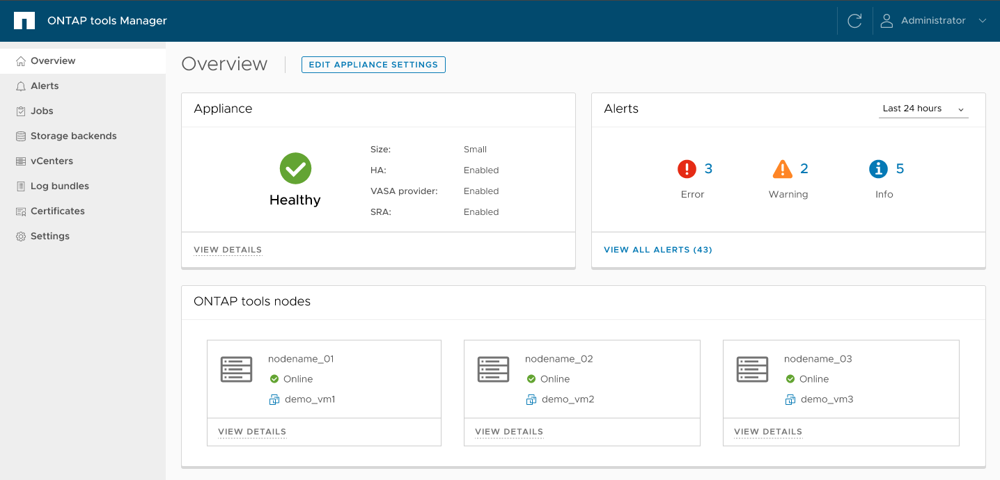

= ONTAP toolsマネージャのユーザーインターフェイスについて学ぶ
:allow-uri-read: 
:icons: font
:imagesdir: ../media/

[role="lead"]
ONTAP tools Managerは、vCenter Serverインスタンス、ストレージ バックエンド、高可用性（HA）やノード スケーリングなどのアプライアンス構成を含む、ONTAP tools for VMware vSphereを管理するために使用するWebベースのコンソールです。マルチテナンシーをサポートしているため、単一のインターフェイスから複数のvCenter Serverインスタンスを管理できます。

ONTAPツール マネージャは、 ONTAP tools for VMware vSphereを管理するための Web ベースのコンソールです。

ONTAPツール マネージャーは次の機能を提供します。

* アラートの管理 - ONTAP tools for VMware vSphereによって生成されたアラートを表示およびフィルタリングします。
* ストレージ バックエンドの管理 - ONTAPストレージ クラスターを追加および管理し、それらを vCenter Server インスタンスにグローバルにマッピングします。
* vCenter Server インスタンスの管理 - ONTAPツール内で vCenter Server インスタンスを追加および管理します。
* ジョブの監視 - ONTAP tools プラグインインターフェースと ONTAP tools Manager インターフェースから開始された非同期ジョブを監視およびデバッグします。期間を指定してジョブを絞り込んだり、ページサイズを調整したり、エラーやサブタスクを含むジョブの詳細を表示したりできます。エラーの詳細を表示するには、失敗ステータスを選択してください。サブタスクのあるジョブの場合は、行を展開して説明とステータスを確認してください。サブジョブについては、ジョブのドリルダウン機能を使用して詳細を表示してください。
* ログ バンドルのダウンロード - ONTAP tools for VMware vSphereのトラブルシューティングを行うためにログ ファイルを収集します。
* 証明書の管理 - 自己署名証明書をカスタム CA 証明書に置き換え、VASA プロバイダーおよびONTAPツールの証明書を更新またはリフレッシュします。
* パスワードのリセット - VASA プロバイダーと SRA のパスワードを変更します。
* アプライアンス設定の管理 - HA の有効化やノード サイズのスケールアップなど、 ONTAPツール アプライアンスを構成します。

ONTAP tools Manager にアクセスするには、ブラウザから `\https://<ONTAPtoolsIP>:8443/virtualization/ui/`を起動し、デプロイ時に指定した ONTAP tools for VMware vSphere の管理者認証情報でログインします。

|===
| *カード* | * 概要 * 

| アプライアンスのカード | アプライアンス カードには、 ONTAPツール アプライアンスの全体的なステータス、構成の詳細、および有効なサービスのステータスが表示されます。詳細情報を表示するには、[詳細を表示] リンクを選択します。アプライアンスの設定を変更すると、変更が完了するまでカードにジョブのステータスと詳細が表示されます。 

| アラートカード | アラート カードには、HA ノード レベルのアラートなど、タイプ別に分類されたONTAPツール アラートが表示されます。カウントハイパーリンクをクリックすると、選択したアラートの種類でフィルタリングされたアラート ページに移動し、詳細なアラートを表示できます。 

| vCentersカード | vCenter カードには、 ONTAPツールによって管理されるすべての vCenter Server インスタンスの健全性ステータスが表示されます。対応するリンクを選択すると、選択したインスタンスの詳細情報を含むページに移動し、各 vCenter の詳細を表示できます。 

| ストレージバックエンドカード | ストレージ バックエンド カードには、 ONTAPツールで設定されているすべてのONTAPストレージ クラスターの健全性と接続ステータスが表示されます。対応するリンクを選択すると、選択したクラスターの詳細情報を含むページに移動し、各ストレージ バックエンドの詳細を表示できます。 

| ONTAP toolsノードカード | ONTAP tools のノードカードには、アプライアンス内のすべてのノードが表示されます。これには、ノード名、VM 名、ステータス、ネットワーク情報が含まれます。特定のノードの詳細情報を表示するには、*詳細を表示*を選択してください。[NOTE] 非 HA 構成では、ノードは 1 つしか表示されません。HA 構成では、3 つのノードが表示されます。 
|===