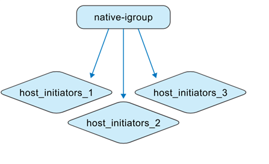
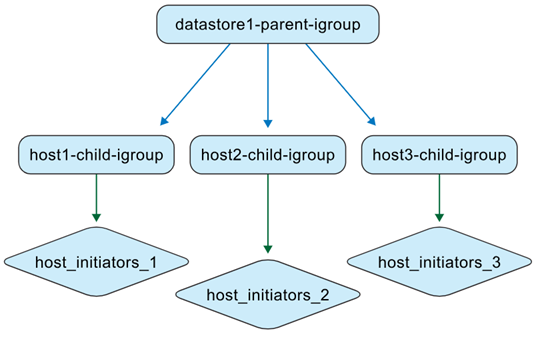
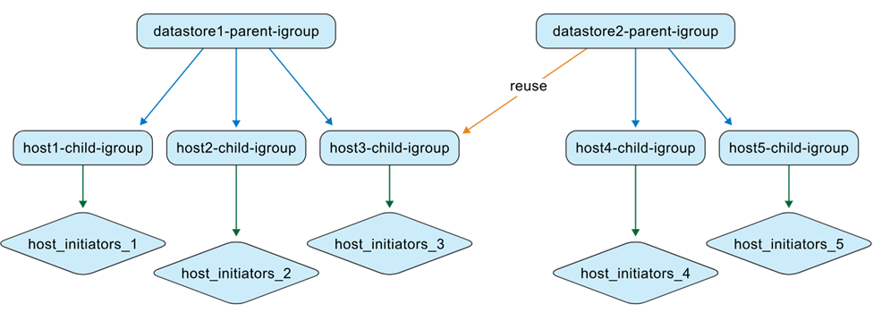
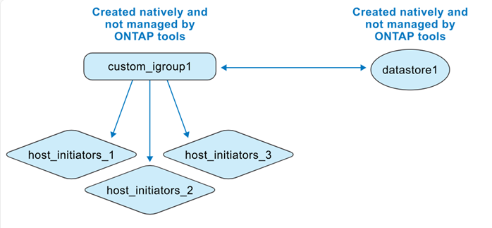
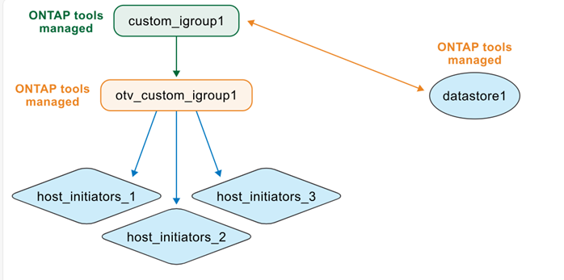

= ONTAP toolsによるigroupの管理方法
:allow-uri-read: 
:icons: font
:imagesdir: ../media/

[role="lead"]
ONTAP tools VMとONTAPストレージシステムの両方を管理する場合、特にONTAP toolsで管理されていない環境から管理されている環境へデータストアを移動する際には、igroupの動作を理解することが重要です。このページでは、ONTAP tools for VMware vSphereがigroupをどのように表現し管理するかについて説明します。これは、以前のリリースと現在のネストされたigroupモデルとの間の動作の違いを理解するための概念的な情報です。

ONTAP tools for VMware vSphere 10.4以降、ONTAP toolsはONTAPおよびvCenterオブジェクトを自動的に作成および維持し、VMwareデータセンター環境におけるデータストア管理を簡素化します。ONTAP tools for VMware vSphere 10.5 P2以降、移行されたigroupは使用されなくなると自動的に削除されます。

[[quick-behavior-summary]]
== 簡単な動作概要

* ONTAP tools で管理される VMFS データストアは、ネストされた igroup を使用します（データストアコンテキストごとに 1 つの親 igroup 、ホストごとに子 igroup ）。
* LUNマッピングは子igroupに適用されます。
* カスタム親igroupは、複数のデータストア間で再利用できます。
* ONTAP tools 9.xから移行されたigroupは再利用できません。

[[igroup-contexts]]
== igroupコンテキスト

ONTAP tools for VMware vSphereは、igroupを2つのコンテキストで処理します。

.ONTAPツール以外で管理されるigroup
ストレージ管理者は、ONTAPシステム上でigroupをフラット構造またはネスト構造として作成できます。次の図は、ONTAPで直接作成されたフラットigroupを示しています。

.ONTAPツールが管理するigroup
データストアを作成すると、ONTAP tools for VMware vSphereはネスト構造でigroupを作成します。

たとえば、データストア 1 がホスト 1、2、3 に作成されてマウントされ、新しいデータストア (データストア 2) がホスト 3、4、5 に作成されてマウントされると、 ONTAPツールは効率的な管理のためにホスト レベルの igroup を再利用します。

[[naming-behavior]]
== 命名の動作

データストアを作成し、igroupフィールドを空白のままにすると、ONTAP toolsは、デフォルトでネストされたigroup構造を作成します。

* 親igroupの命名パターン： `otv_<vcguid>_<host_parent_datacenterMoref>_<datastore_name>`
* 子igroupの命名パターン： `otv_<hostMoref>_<vcguid>`

ONTAP システムインターフェースでは、*親イニシエータグループ*フィールドに親iグループと子iグループ間の関係が表示されます。

[[behavior-by-scenario]]
== シナリオ別の動作

[cols="25,25,25,25"]
|===
| シナリオ | 親igroupの動作 | 子 igroup の動作 | LUNのマッピングと可視性 

| デフォルトのigroup設定で作成されたデータストア | デフォルトの ONTAP tools で管理される親 igroup が作成されます。 | ホストレベルの子igroupは必要に応じて作成されます。 | LUNは子igroupにマッピングされます。データストアはvCenter Serverインベントリに表示されます。 

| カスタムigroup名で作成されたデータストア | 指定された名前でカスタム親igroupが作成されます。 | ホストが重複する場合、既存のホストレベルの子igroupが再利用されます。 | 新しいデータストアLUNは、再利用または新規作成された子igroupにマッピングされます。データストアはvCenter Serverに表示されます。 

| データストア作成時に既存のカスタムigroupが再利用されます | 既存のカスタム親igroupが選択され、再利用されます。 | 子igroupは、ホストのメンバーシップに基づいて再利用または拡張されます。 | 新しいデータストアLUNは、関連付けられた子igroupを介してマッピングされます。データストアはvCenter Serverに表示されます。 

| データストアとigroupはONTAPとvCenterでネイティブに作成され、その後ONTAP toolsによって検出されます | ONTAP toolsは、管理コンテキスト内に親igroupを作成し、元のigroup名を保持します。 | ONTAP tools for VMware vSphereは、元のigroupの名前を `otv_`プレフィックスで変更し、階層内で子igroupとして表します。 | イニシエータのマッピングは変更されません。データストアにマッピングされたigroupのみが、検出時に変換されます。 
|===

[[custom-igroup-reuse-and-api-behavior]]
== カスタムigroupの再利用とAPIの動作

ONTAP tools のユーザーインターフェイスでは、データストアを作成する際に、ドロップダウンリストから既存のカスタム親igroupを再利用できます。

API を通じても同様の動作がサポートされています。データストアの作成時に既存の igroup を再利用するには、 API リクエストのペイロードに igroup の UUID を指定します。

NOTE: 再利用できるのはカスタムigroupのみです。ONTAP tools 9.xから移行されたigroupは再利用できず、ONTAP tools 10.5 P2以降では、使用されなくなると自動的に削除されます。

[[native-to-managed-conversion-view]]
== ネイティブからマネージドへの変換ビュー

ONTAP システムおよびVMware環境でigroupとデータストアを直接作成する場合、ONTAP tools は初期状態ではこれらのオブジェクトを管理しません。これにより、フラットなigroup構造になります。

データストア検出後、ONTAP toolsは、データストアにマッピングされたigroupを識別して登録し、それらをネストされたモデルで表現します。親igroupはデータストアレベルで表現され、既存のigroupは `otv_`プレフィックスを持つ子igroupとして名前が変更され、イニシエータのマッピングは変更されません。

ONTAP tools for VMware vSphereは、ONTAPシステムで作成されたigroupのうち、データストアにマッピングされていないか、ONTAP toolsにリンクされていないigroupを検出または管理しません。検出時に、ONTAP toolsは検出されたデータストアにマッピングされているigroupのみを変換します。その他のigroupは管理対象外のままです。

[[reuse-of-discovered-native-igroups]]
== 検出されたネイティブigroupの再利用

ONTAP tools が検出されたネイティブ igroup を管理すると、その igroup はデータストア作成用のカスタムイニシエータグループ名のドロップダウンリストで使用できるようになります。

新しいデータストアLUNは、正規化された子igroupにマッピングされます。例： `otv_NativeIgroup1`

ONTAP tools for VMware vSphereは、ONTAP tools で管理されていない、またはデータストアにリンクされていないONTAPシステムで作成されたigroupを検出または使用しません。
