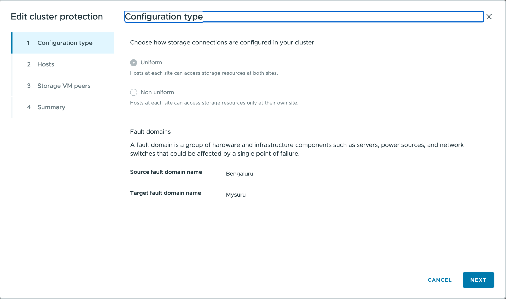

= ONTAP tools を使用してデータストア保護のためにクラスターを設定する
:allow-uri-read: 
:icons: font
:imagesdir: ../media/

[role="lead"]
ONTAP tools for VMware vSphere を使用してクラスタ構成（ホストとストレージの近接性）設定を構成し、仮想化環境における効率的なデータストア保護と合理化されたフェイルオーバー管理を実現します。

.作業を開始する前に
* vSphere の管理者権限があることを確認してください。
* クラスタ構成設定は、均一構成と非均一構成の両方に適用できますが、アクセス設定はAFDタイプの関係にのみ適用されます。

.手順
. vSphere クライアントで、ホストクラスタを右クリックし、*クラスタ保護の構成* を選択します。
+

NOTE: クラスターに既にクラスター構成が存在する場合、このオプションを使用すると既存の構成を編集できます。

. *Configuration type* ウィンドウで：
+
.. *Uniform* を選択すると、両方の障害ドメインのホストが両方のサイトのストレージリソースにアクセスできるようになります。障害ドメインとは、ハードウェアおよびインフラストラクチャコンポーネントのグループです。両サイトにおいて、各ホストを障害ドメインに割り当ててください。
.. 各サイトのホストがそれぞれのサイトのストレージにのみアクセスできるように制限するには、*Non-uniform* を選択してください。ホストを障害ドメインに適切に割り当ててください。
.. 障害ドメイン名を入力してください。デフォルトの名称は「Site A」と「Site B」です。これらの値は編集可能です。サイト名は、ソースおよびターゲットの障害ドメインに対応しています。UIは入力時に内容を検証し、サポートされていない文字や文字数制限を超える値に対してメッセージを表示します。
+

NOTE: 設定タイプは、一度設定すると変更できません。構成タイプを変更するには、クラスタ構成を削除し、目的の設定で新しいクラスタ構成を作成します。

. 「 * 次へ * 」を選択します。
. 「ホスト」ウィンドウで、各ホストをソース障害ドメインまたはターゲット障害ドメインのいずれかに割り当てます。すべてのホストを割り当てる必要があり、1つのホストが両方のサイトに属することはできません。ウィザードに表示されるサイト名は、ソース障害ドメイン名とターゲット障害ドメイン名です。すべてのホストが割り当てられると、「次へ」ボタンが有効になります。
. 「 * 次へ * 」を選択します。
. *Storage SVM peers* ページで、各SVMを適切なサイトに割り当てます。複数のSVMピアを割り当てることができますが、各サイトには少なくとも1つを割り当てる必要があります。SVMをあるサイトに割り当てると、そのピアSVMが自動的に反対側のサイトに割り当てられます。
. 「 * 次へ * 」を選択します。
. 「概要」ページを確認してください。各障害ドメインのクラスタ構成設定を確認してください。
. 設定を適用するには、*作成*を選択してください。
. 既存のクラスタ保護構成を表示または編集するには：
+
.. ONTAP tools プラグイン ビューに移動します。
.. *Protection* > *Cluster protection configuration* に移動します。
.. 現在の構成を表示するには、クラスターを選択してください。
.. 縦の省略記号をクリックし、*編集*を選択して設定を変更します。ウィザードに、編集用の現在の設定が表示されます。
+

.結果
設定が適用され、ONTAP tools プラグインで表示または編集できます。
