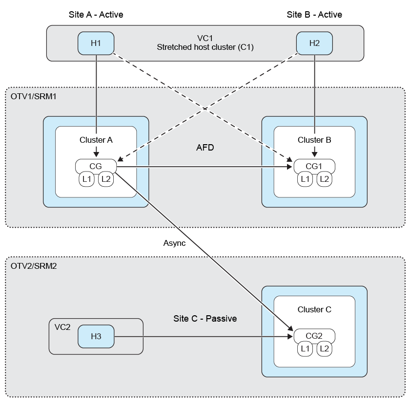

= ONTAP toolsのファンアウト保護
:allow-uri-read: 
:icons: font
:imagesdir: ../media/

[role="lead"]
ファンアウト保護を使用して、2 つのデスティネーション ONTAP クラスタにわたる整合グループを保護します。ONTAP tools は、作成、編集、削除の SnapMirror アクティブ同期保護ワークフローを通じて同期関係を維持し、VMware Live Site Recovery はフェイルオーバーおよび再保護ワークフローを通じて非同期レプリケーション関係を維持します。

NOTE: ファンアウトはSVMユーザーではサポートされていません。

ファンアウト保護を設定するには、3 つのサイト クラスターと SVM をピアリングします。

次の図は、ファンアウト保護設定を示しています：

例

条件：

* ソース整合性グループはクラスタc1とSVM svm1にあります
* 1つ目のデスティネーション整合性グループがクラスタc2およびSVM svm2上にあり、
* 2つ目のデスティネーション整合性グループはクラスタc3とSVM svm3にあります。

それから、

* ソースONTAPクラスタのクラスタピアリングは、（c1、c2）および（c1、c3）になります。
* 最初のデスティネーションONTAPクラスタのクラスタピアリングは、（c2、c1）および（c2、c3）と
* 2番目のデスティネーションONTAPクラスタのクラスタピアリングは、（c3、c1）および（c3、c2）になります。
* ソースSVMのSVMピアリングは（svm1、svm2）と（svm1、svm3）になります。
* 1つ目のデスティネーションSVMでのSVMピアリングは、（svm2、svm1）と（svm2、svm3）と
* 2番目のデスティネーション SVM に対する SVM ピアリングは （svm3, svm1） と （svm3, svm2） になります。

image:../media/fan-out-protection-relationship.png["ファンアウト保護関係"]

.手順
. 新しいプレースホルダーデータストアを選択してください。段階的保護のためのプレースホルダーデータストア選択基準は以下のとおりです：
+
** 保護しているホスト クラスターにプレースホルダー データストアを配置しないでください。
** ホスト クラスタにプレースホルダ データストアを含める必要がある場合は、SnapMirror アクティブ同期保護を設定する前に、VMware Live Site Recovery アプライアンスに追加してください。この設定では、プレースホルダ データストアを保護対象から外すことができます。
+
詳細については、 https://techdocs.broadcom.com/us/en/vmware-cis/live-recovery/site-recovery-manager/8-8/site-recovery-manager-administration-8-8/about-placeholder-virtual-machines/configure-a-placeholder-datastore.html["プレースホルダーデータストアを選択してください"]を参照してください。

. link:../protect/protect-multiple-ds.html["クラスタ内のデータストアを保護する"]に従って、データストアをホストクラスタ保護に追加します。非同期ポリシータイプと同期ポリシータイプの両方を追加します。

